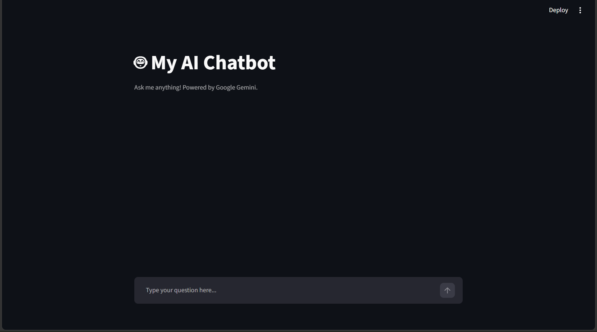

#  AI Chatbot

An interactive AI-powered chatbot built using Python, Streamlit, and Google's Gemini API.

## Features

- Real-time AI-powered conversations
- Google Gemini API integration
- Interactive chat interface
- Conversation history during the session
- Secure API key management using environment variables
- Error handling for API failures and quota limits

## Tech Stack

- Python
- Streamlit
- Google Gemini API
- Google GenAI SDK
- Python-dotenv

## Installation and Setup

1. Clone the repository:

   ```bash
   git clone https://github.com/vineetharajeev/AI-Chatbot.git
   cd AI-Chatbot
   ```

2. Create a virtual environment:

   ```bash
   python -m venv venv
   ```

3. Activate it on Windows:

   ```bash
   venv\Scripts\activate
   ```

4. Install dependencies:

   ```bash
   pip install -r requirements.txt
   ```

5. Create a `.env` file in the project folder:

   ```text
   GEMINI_API_KEY=your_gemini_api_key
   ```

6. Run the application:

   ```bash
   python -m streamlit run app.py
   ```

7. Open the local URL displayed in your terminal.

## API Key

Get your Gemini API key from [Google AI Studio](https://aistudio.google.com/apikey).

Never share or upload your API key.

## What I Learned

- Integrating external AI APIs into Python applications
- Building interactive applications with Streamlit
- Managing environment variables securely
- Handling API errors and quota limitations
- Maintaining conversation history using Streamlit session state

- ## Application Screenshot



## Author

**Vineeth Rajeev**

